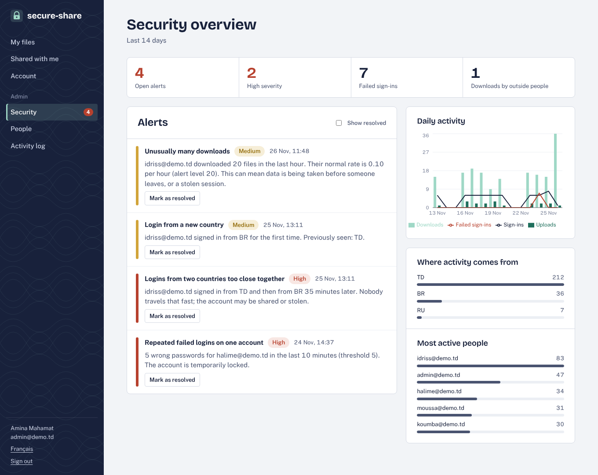
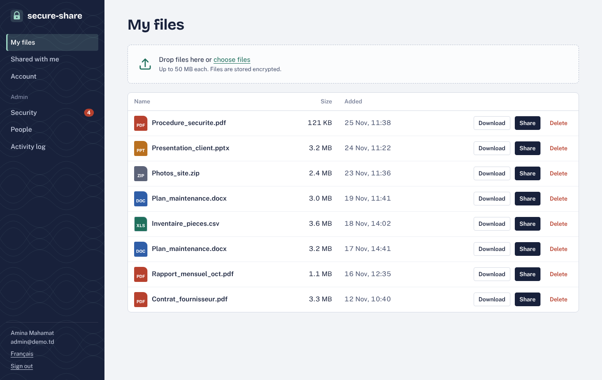
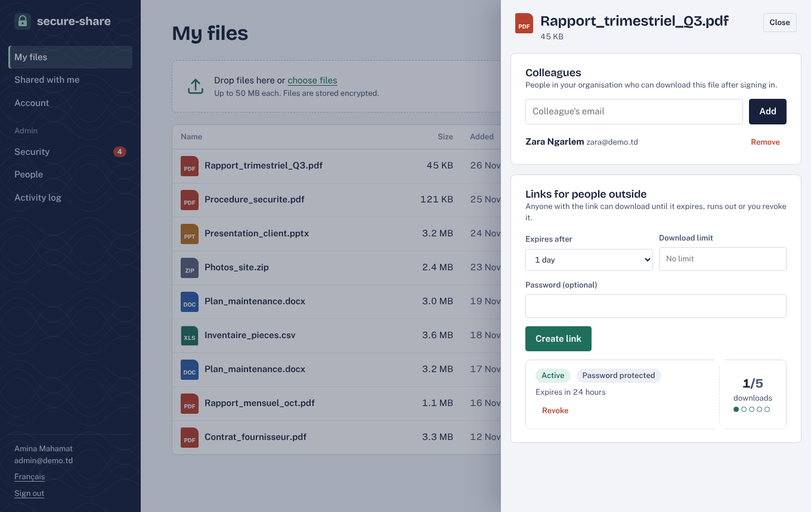
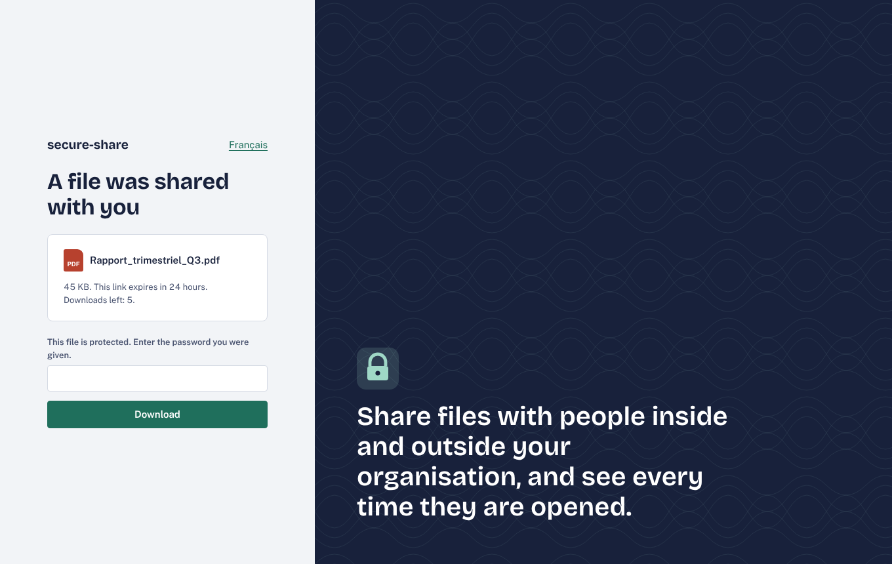
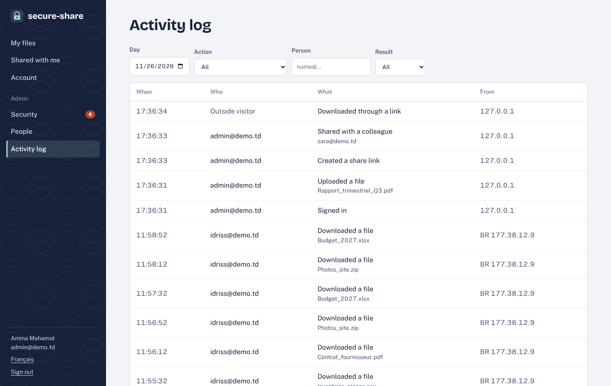
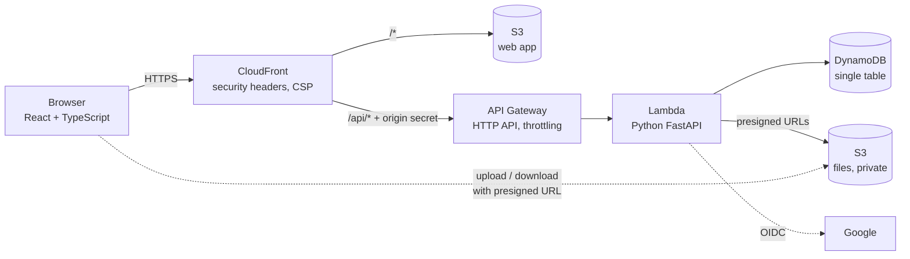

# secure-share

[](https://github.com/Abakar-Fatime/secure-share/actions/workflows/ci.yml)

**Share files safely with colleagues and with people outside your organisation, and know every time a file is opened.**

secure-share is a full-stack web application for sending sensitive documents without email attachments or messaging apps. Files sit in private cloud storage, every access is logged, and a detection engine flags suspicious behaviour (stolen passwords, logins from two countries at once, someone downloading everything before leaving) with a plain-language explanation an admin can act on.



| | |
|---|---|
|  |  |
|  |  |

## What it does

**For everyone**
- Sign in with email and password or **Google (OpenID Connect SSO)**, plus optional **two-step verification** with any authenticator app (TOTP).
- Upload files up to 50 MB straight to encrypted S3 storage.
- Share with colleagues, who then sign in to download.
- Create **links for people outside**, each with an expiry time (1 hour to 30 days), an optional download limit and an optional password. Revoke any link instantly.
- Interface in **English and French**.

**For admins**
- Invite people (invite-only accounts with one-time links), set roles (admin, member, viewer), disable accounts, reset two-step verification.
- **Security overview**: daily activity, failed sign-ins, outside downloads, and open alerts with the reason each was raised.
- **Activity log** of every sign-in, upload, download, share and admin action, filterable by day, action, person and result.

## Architecture



- **Frontend**: React 19, TypeScript, Vite, React Router, Recharts. No UI framework; a small custom design system.
- **Backend**: Python 3.12, FastAPI, running on AWS Lambda through Mangum. The same app runs locally with Uvicorn.
- **Data**: DynamoDB single-table design (users, files, links, audit events, alerts) with one secondary index; key layout documented in [`backend/app/store.py`](backend/app/store.py).
- **Files**: never pass through the API. The browser uploads and downloads directly with **presigned S3 URLs** that expire after 60 seconds (downloads) or 5 minutes (uploads), and are only issued after an access check.
- **Infrastructure as code**: everything in [`infra/terraform`](infra/terraform) (Lambda, API Gateway, DynamoDB, two S3 buckets, CloudFront, IAM, budget alarm).
- **CI/CD**: GitHub Actions runs lint, tests, dependency audits, Terraform validation, a Lambda build and a Docker smoke test on every push. Deployment uses **GitHub OIDC**, so no AWS access keys are stored anywhere.

## Security design

| Threat | Protection |
|---|---|
| Stolen or guessed passwords | Argon2id hashing, 12-character password policy, lock after 5 failures in 15 min, TOTP two-step verification (required for admins), TOTP codes cannot be replayed |
| Telling which emails have accounts | Same error and same timing for "wrong password" and "no such user" |
| Session theft | HttpOnly, Secure, SameSite cookies; all other sessions end when a password is changed, a role changes, an account is disabled or two-step verification is turned off or reset |
| Cross-site request forgery | Double-submit CSRF token on every state-changing request |
| Leaked share links | Only a SHA-256 hash of each link token is stored; links expire, can be limited and revoked; password-protected links lock after 5 wrong guesses |
| Reading someone else's file | Every download checked against owner, colleague grant or admin role; unknown files return 404 so their existence is not revealed |
| Bypassing CloudFront | CloudFront adds a secret header; the API rejects requests without it, so viewer IP/country headers cannot be forged |
| Browser attacks | Strict Content Security Policy, HSTS, `X-Frame-Options: DENY`, `nosniff`, no referrer |
| Over-privileged cloud access | Lambda can only touch its own table, its bucket's `files/` prefix and its log group; deploy role trusts only this repository's `main` branch |
| Runaway cost or abuse | API Gateway throttling, 50 MB upload cap enforced in the S3 upload policy, optional AWS budget alert |

Google sign-in uses the authorization-code flow with **PKCE**, `state` and `nonce`, and verifies the ID token's signature, issuer, audience, expiry and `email_verified`. Accounts are invite-only: Google can only sign in to an account an admin created.

## Suspicious-activity detection

Every audit event is checked by nine rules in [`backend/app/detector.py`](backend/app/detector.py): repeated failed logins, password spraying across accounts, login from a new country, logins from two countries too close together, unusually many downloads compared with the person's own two-week baseline, sign-ins at unusual hours for that person, link-password guessing, mass link creation and mass deletion. Alerts are de-duplicated and explain themselves, for example:

> idriss@demo.td signed in from TD and then from BR 35 minutes later. Nobody travels that fast; the account may be shared or stolen.

The rules were measured with [`scripts/evaluate_detector.py`](backend/scripts/evaluate_detector.py), which simulates 30 days of activity for 40 people (about 22,000 events per run), injects labelled attacks, and replays everything through the production rules. Over 5 runs:

| Metric | Result |
|---|---|
| Attacks detected | **251 / 270 (93.0%)** |
| Alert precision | **84.8%** (290 alerts on attacks, 52 on normal activity) |
| False alarms | **8.7 per 1,000 user-days** (about one every three days for a 40-person team) |

Brute force, password spraying, stolen credentials used abroad, link-password guessing, mass link creation and mass deletion were caught every time; data exfiltration 98%; night-time logins 40%, because that rule deliberately waits for 30 logins of history before judging someone. Two attack styles built to stay under the thresholds (a slow password guesser and slow exfiltration over a full day) are reported as known blind spots. Full results: [`docs/detector-evaluation.md`](docs/detector-evaluation.md).

## Tests

| Part | Tests | Coverage |
|---|---|---|
| Backend (pytest, AWS mocked with moto) | 76 | 94% |
| Frontend (Vitest, Testing Library) | 14 | 60% |

Backend tests cover the full API through HTTP: sign-in, lockout, TOTP enrolment and replay, CSRF, invites, role changes ending sessions, file access rules, link expiry, limits and password locking, OIDC token validation, the CloudFront origin check, and each detection rule.

## Run it locally

With Docker:

```bash
docker compose up --build
```

Open http://localhost:5173 and sign in as `admin@demo.td` / `Demo-Password-2026`. The admin account uses two-step verification: add the key `JBSWY3DPEHPK3PXPJBSWY3DPEHPK3PXP` to any authenticator app (or, with `pyotp` installed, run `python -c "import pyotp; print(pyotp.TOTP('JBSWY3DPEHPK3PXPJBSWY3DPEHPK3PXP').now())"`). The demo data includes 14 days of activity and a few staged attacks. Other demo users (`idriss@demo.td`, `zara@demo.td`, …) use the same password without two-step verification.

Without Docker:

```bash
# terminal 1: local AWS (DynamoDB + S3 emulator)
cd backend && python -m venv .venv && . .venv/bin/activate
pip install -r requirements-dev.txt
moto_server -p 5050

# terminal 2: API
cd backend && . .venv/bin/activate
export SS_AWS_ENDPOINT_URL=http://localhost:5050 AWS_ACCESS_KEY_ID=local AWS_SECRET_ACCESS_KEY=local
python -m app.cli init-local && python -m app.cli seed-demo
uvicorn app.main:app --port 8000

# terminal 3: web app
cd frontend && npm ci && npm run dev
```

Run the checks:

```bash
cd backend && ruff check . && pytest --cov
cd backend && python -m scripts.evaluate_detector --seeds 5
cd frontend && npm run lint && npm run typecheck && npm test
```

## Deploy to AWS

Deployment is fully automated by GitHub Actions after a one-time setup (about 15 minutes, no command line needed). Step-by-step guide: [`docs/deploy.md`](docs/deploy.md).

## Project layout

```
backend/
  app/            FastAPI app: routers, auth, store (DynamoDB), detector, audit
  scripts/        detector evaluation
  tests/          pytest suite
frontend/src/     React app: pages, components, i18n (EN/FR)
infra/
  bootstrap/      one-time CloudFormation stack (GitHub OIDC role + Terraform state bucket)
  terraform/      all application infrastructure
.github/workflows CI and deployment
docs/             detector evaluation, deployment guide, design walkthrough
```

## Author

Abakar Sougui Fatime ([github.com/Abakar-Fatime](https://github.com/Abakar-Fatime)). MIT licence.
